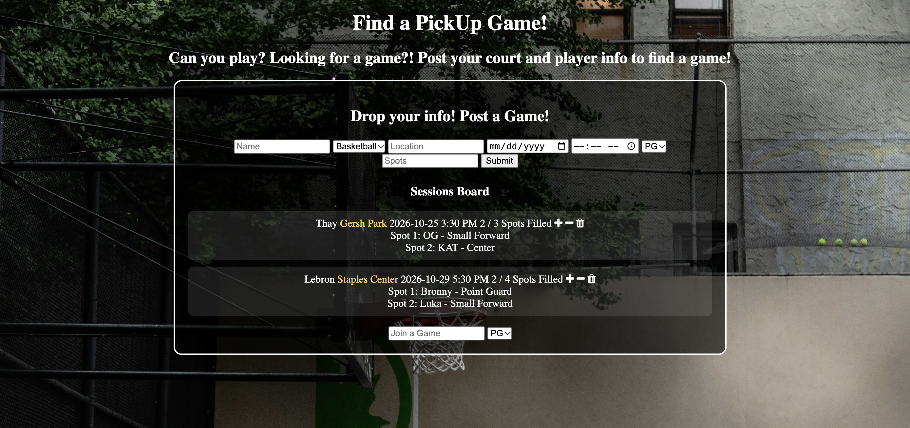

# Pick Up Hoops

Find a pickup basketball game, or post your own.

Pick Up Hoops is a full-stack CRUD app where players post a game — court, date, time, and how many spots are open — and other players claim a spot until the run is full.



**Live demo:** https://pickup-hoops-2.onrender.com

## What it does

- **Post a game** — your name, the court location, the date and time, your position, and the number of open spots. Basketball is the only sport in the form right now (football is commented out in the code).
- **Sessions board** — every posted game shows the host, the court, the date, the time in 12-hour format, and how many spots are filled.
- **Join a game** — type your name in **Join a Game**, pick your position, and click **+** on a session. Your name and position show up in the roster as `{name, position}`. Joining uses `$addToSet`, so the same name-and-position can't be added twice to one game.
- **Spot limits** — once a game is full, nobody else can join, and the app tells you: "All spots in this session are filled!"
- **Leave a game** — type your name and click **−** to give your spot back.
- **Delete a game** — click the trash icon to remove a session.
- **Directions** — click any court name to open Google Maps directions to it.
- **No accounts** — there is no sign-up or login in this app. Anyone can post, join, leave, or delete a game.

## Tech stack

- Node.js + Express 4
- EJS templates (server-side rendered)
- MongoDB (Atlas) using the native `mongodb` driver — no Mongoose, no Passport
- Vanilla JavaScript (Fetch API), CSS, Font Awesome icons

## Getting started

1. Clone the repo and install dependencies:

   ```bash
   git clone https://github.com/tbrown320/pickup-hoops.git
   cd pickup-hoops
   npm install
   ```

2. Create a `.env` file in the project root with your MongoDB connection string:

   ```
   MONGO_URI=your-mongodb-connection-string
   ```

   The app uses a database named `pickup-games` with a `games` collection. MongoDB creates both automatically the first time you post a game. `.env` is gitignored — never commit it.

3. Start the server:

   ```bash
   npm start
   ```

4. Open http://localhost:3005 in your browser. To use a different port, set the `PORT` environment variable.

## Project structure

```
server.js              - app entry point and all routes (port 3005, or $PORT)
views/
  index.ejs            - the whole app: post-a-game form, sessions board, join box
public/
  main.js              - join, leave, and delete (Fetch: PUT /games, PUT /games/leave, DELETE /games)
  styles.css           - layout and streetball background
  font-awesome.min.css - icons (local copy)
  fonts/               - Font Awesome font files
  streetball_background.jpg, streetball_2.jpg, s3.jpeg, s4.jpg, 21savage.jpg
                         - background and page images
index.html             - unused starter file (the app serves views/index.ejs)
```

## Roadmap - Future Updates

- User accounts, so only the host can delete their own game (right now anyone can delete any game)
- Edit a posted game (date, time, or spots) — currently you can only delete and re-post
- Sort or filter the sessions board by date

---

Thay Brown — thaybrown22@gmail.com · https://thaythecoder.netlify.app · https://github.com/tbrown320 · https://www.linkedin.com/in/thaybrown
