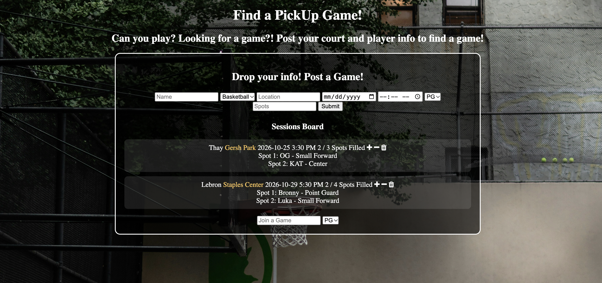

# Pick Up Hoops

Find a pickup basketball game, or post your own. Pick Up Hoops is a full-stack CRUD app where players post a game (court, date, time, and how many spots are open) and other players claim a spot until the run is full.



**Live Link** Hosted at: https://pickup-hoops-2.onrender.com

## Features

- **Post a game:** enter your name, the court location, the date and time, your position, and the number of open spots.
- **Sessions board:** every posted game shows the host, the court, the date, the time (in 12-hour format), and how many spots are filled.
- **Join a game:** type your name in **Join a Game**, pick your position, and click **+** on a session. Your name and position show up in the roster.
- **Spot limits:** once a game is full, nobody else can join, and the app tells you so.
- **No duplicate sign-ups:** the same player can't take two spots in one game.
- **Leave a game:** type your name and click **−** to give your spot back.
- **Delete a game:** click the trash icon to remove a session.
- **Directions:** click any court name to open Google Maps directions to it.

## Tech Stack

- **Backend:** Node.js, Express
- **Database:** MongoDB (Atlas) using the native `mongodb` driver
- **Templating:** EJS (server-side rendered)
- **Frontend:** vanilla JavaScript (Fetch API), CSS, Font Awesome icons

## Getting Started

### Prerequisites

- [Node.js](https://nodejs.org/) and npm
- A MongoDB database, either a free [MongoDB Atlas](https://www.mongodb.com/atlas) cluster or a local MongoDB install

### Installation

1. Clone the repo:
   ```bash
   git clone <your-repo-url>
   cd pickup-hoops
   ```
2. Install dependencies:
   ```bash
   npm install
   ```
3. Create a `.env` file in the project folder with your MongoDB connection string:
   ```
   MONGO_URI=your-mongodb-connection-string
   ```
   The app uses a database named `pickup-games` with a `games` collection, and MongoDB creates both automatically the first time you post a game.

### Running the app

```bash
npm start
```

Then open **http://localhost:3005** in your browser.
